<p align="center">
  
</p>

<p align="center">
  <a href="https://github.com/cahigar">
    
  </a>
</p>

<p align="center">
  <a href="https://www.linkedin.com/in/carloshidalgogarcia/"></a>
  <a href="https://grid.carloshidalgo.eu"></a>
  <a href="https://profesor.carloshidalgo.eu"></a>
  
</p>

<br/>

```python
class CarlosHidalgo:
    rol       = "Profesor de Programación e IA · Ingeniero de Telecomunicaciones"
    base      = "Bilbao, España 🇪🇸"
    enseño    = ["Python", "Entornos de Desarrollo", "Cloud Computing", "Programación de IA"]
    construyo = ["juegos educativos", "plataformas docentes", "apps con LLMs", "sistemas RAG"]
    me_mueve  = "que aprender a programar se sienta como jugar, y que la IA sume, no sustituya"

    def ahora(self):
        return ["G.R.I.D. en el aula", "CODESEUM", "Prismas + IA", "agentes y LLMs locales"]
```

## 🚀 Proyectos destacados

<!--PROYECTOS:start-->
<p align="center">
<a href="https://grid.carloshidalgo.eu"></a>
<a href="https://profesor.carloshidalgo.eu"></a>
<a href="https://github.com/cahigar/prismas"></a>
<a href="https://github.com/cahigar/nightslord"></a>
</p>
<!--PROYECTOS:end-->

<sub>Los que dicen <b>EN PRODUCCIÓN</b> están desplegados y se usan con alumnado real. Clic en cualquier tarjeta para verlo.</sub>

## 🧠 Stack

<p align="center">
  
  <br/>
  
  <br/>
  
</p>

<table>
<tr>
<td width="50%" valign="top">

**🤖 IA aplicada**
- LLMs locales y en la nube (Ollama, OpenAI)
- RAG con embeddings y FAISS · LangChain
- Sistemas multiagente y *tool use*
- Visión artificial con OpenCV y MediaPipe
- NLP y procesamiento de documentos

</td>
<td width="50%" valign="top">

**🎓 Docencia que se programa**
- Juegos donde se aprende escribiendo código
- Plataformas con evaluación por RA/CE
- Material técnico con Python ejecutable
- Proyectos reales para el alumnado
- Mentoría en IA y desarrollo profesional

</td>
</tr>
</table>

## 📡 En directo

<p align="center">
  
</p>

**Últimos movimientos**

<!--RECIENTE:start-->
| Repo | Qué es | Lenguaje | Último push |
|:--|:--|:--:|--:|
| [**nightslord**](https://github.com/cahigar/nightslord) |  | `TypeScript` | hace 4 días |
| [**grid**](https://github.com/cahigar/grid) | Juego educativo | `TypeScript` | hace 20 días |
| [**orbita-drones**](https://github.com/cahigar/orbita-drones) |  | `Java` | hace 23 días |
| [**RepositorioPrueba1**](https://github.com/cahigar/RepositorioPrueba1) | Prueba1 |  | hace 6 meses |
<!--RECIENTE:end-->

<p align="center">
  <picture>
    <source media="(prefers-color-scheme: dark)" srcset="https://raw.githubusercontent.com/cahigar/cahigar/output/github-contribution-grid-snake-dark.svg"/>
    <source media="(prefers-color-scheme: light)" srcset="https://raw.githubusercontent.com/cahigar/cahigar/output/github-contribution-grid-snake.svg"/>
    
  </picture>
</p>

---

<p align="center">
  <i>«La IA no sustituye a los programadores… sustituye a los que no entienden lo que hacen.»</i>
</p>

<p align="center">
<!--ACTUALIZADO:start-->
<sub>⚙️ Secciones regeneradas automáticamente por GitHub Actions · 27 de octubre de 2026 a las 18:41</sub>
<!--ACTUALIZADO:end-->
</p>
