<p align="center">
  
</p>

<p align="center">
  <a href="https://carloshidalgo.eu">
    
  </a>
</p>

<p align="center">
  <a href="https://carloshidalgo.eu"></a>
  <a href="https://carloshidalgo.eu/cv_carlos_hidalgo.pdf"></a>
  <a href="https://www.linkedin.com/in/carloshidalgogarcia/"></a>
  <a href="mailto:carlos.hidalgo.gar@gmail.com"></a>
  <a href="https://nativosia.es"></a>
</p>

<p align="center"><i>Conecto educación, programación e inteligencia artificial para que las cosas pasen.<br/>Intento explicarlo bien. A veces incluso lo consigo.</i></p>

<p align="center">
  
</p>

```python
class CarlosHidalgo:
    rol        = "Ingeniero de Telecomunicaciones · Docente de FP en IA y Big Data · Builder"
    base       = "Bilbao, España 🇪🇸"
    idiomas    = ["Español", "Inglés C1"]
    enseño     = ["Programación de IA", "Python", "Servicios y Procesos", "Aplicaciones Web", "Cloud Computing"]
    construyo  = ["juegos educativos", "asistentes con RAG", "APIs con FastAPI", "agentes", "webs reales"]
    vengo_de   = ["RF y microondas", "smart grids", "redes satelitales VSAT/Starlink"]

    def superpoder(self):
        return "hablar de arquitectura con un CTO y explicar lo mismo a un alumno de primero"
```

## 🚀 Proyectos destacados

<!--PROYECTOS:start-->
<p align="center">
<a href="https://grid.carloshidalgo.eu"></a>
<a href="https://profesor.carloshidalgo.eu"></a>
<a href="https://carloshidalgo.eu/prismas-demo.html"></a>
<a href="https://mooonsters.com"></a>
<a href="https://hilandolineas.es"></a>
<a href="https://nativosia.es"></a>
<a href="#"></a>
</p>
<!--PROYECTOS:end-->

<sub><b>ONLINE</b> y <b>DEMO EN VIVO</b> se pueden probar ya: clic en la tarjeta. G.R.I.D. y CODESEUM se usan en clase con alumnado real.</sub>

<details>
<summary><b>⚗️ Más en el laboratorio</b> — RAG, orientación con IA, visión artificial…</summary>
<br/>

| Proyecto | Qué hace | Stack | Estado |
|:--|:--|:--|:--:|
| **Mentoruco** | Chatbot que orienta al alumnado hacia el ciclo de FP más adecuado en Cantabria | LLMs · Python · FastAPI | demo |
| **Asistente RAG documental** | Lee documentos, los indexa y responde con recuperación semántica | FAISS · ChromaDB · sentence-transformers | en desarrollo |
| **Lore** | Coherencia para novelas de fantasía: capítulos, personajes y sugerencias con IA local | FastAPI · SQLAlchemy · Ollama · RAG | en desarrollo |
| **Fit&Play** | Fitness con visión artificial: la cámara detecta tus movimientos en 25 minijuegos | MediaPipe · OpenCV · WebSockets | en desarrollo |
| **Liga Solidaria** | IA y Big Data aplicadas al deporte inclusivo, con seguimiento de movimiento | pandas · scikit-learn · OpenCV | prototipo |
| **[Demos docentes Python / IA](https://lawngreen-wolf-906487.hostingersite.com/)** | Notebooks y retos para enseñar Python, IA, APIs, visión y NLP en FP | Jupyter · pandas · FastAPI | activo |
| **[El Lab](https://carloshidalgo.eu/lab.html)** | CSV Explorer, Dashboard, API Playground y Article Forge, en el navegador | Python · JS · Claude API | online |
| **[Asistente de mi web](https://carloshidalgo.eu)** | Responde sobre mi perfil en menos de 2 s, en una función *serverless* | Claude Haiku · Vercel | online |

</details>

## 🛰️ Trayectoria

<p align="center">
  
</p>

<details>
<summary><b>📄 Investigación y publicaciones</b> — IEEE con Thales Alenia Space y tres matrículas de honor</summary>
<br/>

- **[Low Cost S-Band Phase Modulator for Modern TTC Applications](https://ieeexplore.ieee.org/document/8541530)** · IEEE, 2018 — modulador de fase en banda S para telemetría y telecomando, en colaboración con **Thales Alenia Space**.
- **[RADAR MIMO de Banda Ultra Ancha](https://repositorio.unican.es/xmlui/bitstream/handle/10902/12154/400151.pdf?sequence=1&isAllowed=y)** · TFM, Universidad de Cantabria, 2016 — ✦ Matrícula de Honor.
- **[Transmisor MIMO-UWB con divisor de potencia de 6 vías](https://repositorio.unican.es/xmlui/handle/10902/7349)** · Ponencia URSI, 2015 — ✦ Matrícula de Honor.
- **[Diseño RF de un transmisor MIMO-UWB](https://repositorio.unican.es/xmlui/bitstream/handle/10902/7636/Dise%C3%B1o%20RF.pdf?sequence=1&isAllowed=y)** · TFG, Universidad de Cantabria, 2014 — ✦ Matrícula de Honor.

</details>

<details>
<summary><b>🎓 Formación y certificaciones</b></summary>
<br/>

| | |
|:--|:--|
| 🎓 Máster en Formación del Profesorado | Universidad de Cantabria · 2019 |
| 📡 Máster en Ingeniería de Telecomunicaciones | Universidad de Cantabria · 2014 |
| 🔬 Grado en Ingeniería de Telecomunicaciones | Universidad de Cantabria · 2012 |
| ☁️ AWS Instructor Certification | Amazon Web Services · 2023 |
| 🌐 Cisco CCNA v7: Introduction to Networks | Cisco Networking Academy · 2022 |
| 🔐 Iniciación al análisis de malware | Ciberseguridad · 2023 |
| 🎮 Desarrollo de videojuegos con Unity | 2022 |
| 🤖 Robótica con Arduino e impresión 3D | 2021 |

</details>

## 🧠 Stack

<p align="center">
  
  <br/>
  
  <br/>
  
</p>

<p align="center">
  
  
  
  
  
  
  
  
</p>

<table>
<tr>
<td width="50%" valign="top">

**🤖 IA aplicada**
- Asistentes con RAG, embeddings y búsqueda semántica
- Agentes autónomos, MCP y *function calling*
- LLMs en la nube y locales (Claude, GPT, Gemini, Ollama)
- Visión artificial con OpenCV y MediaPipe
- APIs y automatización con Python y FastAPI

</td>
<td width="50%" valign="top">

**🎓 Docencia que se programa**
- Juegos donde se aprende escribiendo código
- Plataformas con evaluación por RA/CE
- Material técnico con Python ejecutable
- Retos y proyectos que conectan empresa y aula
- Tutor FEM y orientación en FP

</td>
</tr>
</table>

## 🔁 Cómo trabajo

<p align="center">
  <b>🔍 Escuchar</b> &nbsp;→&nbsp; <b>⚡ Prototipar</b> &nbsp;→&nbsp; <b>🔨 Construir</b> &nbsp;→&nbsp; <b>🔁 Iterar</b> &nbsp;→&nbsp; <b>📦 Entregar</b>
  <br/>
  <sub>Primero el problema, luego la tecnología. Un prototipo feo que funciona vale más que un documento perfecto que nadie usa.</sub>
</p>

## 📡 En directo

<p align="center">
  
</p>

**Últimos movimientos**

<!--RECIENTE:start-->
| Repo | Qué es | Lenguaje | Último push |
|:--|:--|:--:|--:|
| [**prismas**](https://github.com/cahigar/prismas) | Editor de presentaciones para docencia técnica con IA integrada y Python ejecutable en el navegador (Next.js · React · Pyodide · OpenAI) | `TypeScript` | hoy |
| [**nightslord**](https://github.com/cahigar/nightslord) | 🦇 Mooonsters: multijugador .io en pixel art con 30 monstruos que cazan de noche. Servidor autoritativo en Node y sprites, mapas y sonido 100 % procedurales. | `TypeScript` | hace 5 días |
| [**grid**](https://github.com/cahigar/grid) | 🤖 Juego de estrategia isométrico donde el alumnado programa robots en Python y compite en directo con su clase. Intérprete Python propio en TypeScript. | `TypeScript` | hace 21 días |
| [**orbita-drones**](https://github.com/cahigar/orbita-drones) | 🛰️ Proyecto de prácticas en Java para aprender Git: commits, ramas, pull requests y conflictos sobre una tienda de drones orbitales (1.º DAM · Entornos de Desarrollo). | `Java` | hace 24 días |
<!--RECIENTE:end-->

<p align="center">
  <picture>
    <source media="(prefers-color-scheme: dark)" srcset="https://raw.githubusercontent.com/cahigar/cahigar/output/github-contribution-grid-snake-dark.svg"/>
    <source media="(prefers-color-scheme: light)" srcset="https://raw.githubusercontent.com/cahigar/cahigar/output/github-contribution-grid-snake.svg"/>
    
  </picture>
</p>

## 🎯 Nueva misión disponible

<p align="center">
  <b>¿Tienes una idea que convertir en algo real?</b><br/>
  Una herramienta con IA, una web, un proyecto educativo, una demo técnica o una colaboración.<br/>
  Si tiene tecnología en el centro, podemos hablarlo. Respondo en menos de 24 horas.
  <br/><br/>
  <a href="mailto:carlos.hidalgo.gar@gmail.com"></a>
  <a href="https://carloshidalgo.eu/#contacto"></a>
  <a href="https://carloshidalgo.eu/cv_carlos_hidalgo.pdf"></a>
</p>

---

<p align="center">
  <i>«La IA no sustituye a los programadores… sustituye a los que no entienden lo que hacen.»</i>
  <br/>
  <sub>Ingeniero que entiende sistemas · Docente que sabe explicarlos · Builder que los construye</sub>
</p>

<p align="center">
<!--ACTUALIZADO:start-->
<sub>⚙️ Secciones regeneradas automáticamente por GitHub Actions · 28 de octubre de 2026 a las 17:13</sub>
<!--ACTUALIZADO:end-->
</p>
